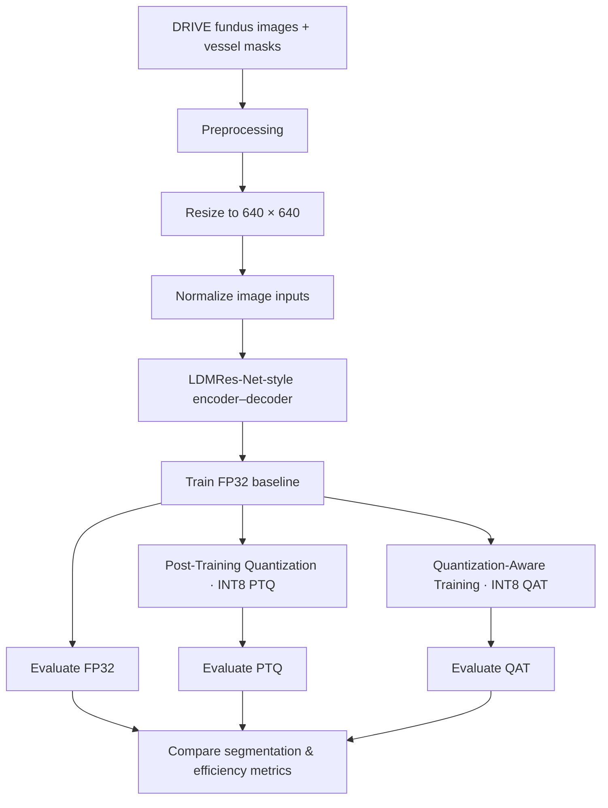

<div align="center">

# QuantVessel —Retinal Vessel Segmentation


**[Overview](#overview) · [Architecture](#architecture--workflow) · [Results](#experimental-results) · [Getting Started](#getting-started) · [Citation](#citation)**

</div>
## Overview
QuantVessel explores a practical computer-vision challenge: **can an already compact retinal-vessel segmentation network be made smaller and faster through INT8 quantization while retaining useful segmentation quality?**

| Variant | What changes | Research purpose |
|---|---|---|
| **FP32 baseline** | Full-precision training/inference | Establish reference quality and efficiency |
| **INT8-PTQ** | Quantization applied after FP32 training | Test low-effort compression |
| **INT8-QAT** | Quantization effects considered during training | Recover quality under lower precision |

The focus is on **F1 score, vessel sensitivity, specificity, overall accuracy, model size, and inference time**, rather than only accuracy.

## Research question
> How much model size and inference latency can be saved with INT8 compression, and what does that cost in the detection of fine retinal vessels?

## Architecture & workflow



### Model design, at a glance


### Why quantization matters

- **PTQ** can reduce storage and computation without retraining the complete full-precision model, but may degrade fine-structure detection.
- **QAT** exposes the model to quantization effects during optimization, potentially protecting sensitivity to thin vessels.
- **Edge-oriented efficiency** means looking beyond prediction quality at storage footprint, latency, and target-hardware compatibility.

## Dataset

The project uses **DRIVE (Digital Retinal Images for Vessel Extraction)**, with **40 color fundus images**, split into **20 training** and **20 test** images. It includes vessel annotations and field-of-view masks.
```text
data/
└── DRIVE/
    ├── training/
    │   ├── images/
    │   ├── 1st_manual/
    │   └── mask/
    └── test/
        ├── images/
        ├── 1st_manual/
        └── mask/
```

## Experimental setup

| Setting | Value documented in repository |
|---|---|
| Architecture | LDMRes-Net-style network |
| Framework | PyTorch |
| Input resolution | 640 × 640 |
| Optimizer | Adam |
| Initial learning rate | `1e-3` |
| Weight decay | `1e-4` |
| Batch size | 2 |
| Training epochs | 200 |
| Loss | Dice loss |
| Comparisons | FP32 / INT8-PTQ / INT8-QAT |

## Experimental results

**Repository-reported results** (not independently reproduced):

| Metric | FP32 | INT8-PTQ | INT8-QAT |
|:--|--:|--:|--:|
| F1 score | **79.10%** | 77.48% | 77.66% |
| Sensitivity | **79.30%** | 74.41% | 77.88% |
| Specificity | 98.00% | **98.37%** | 97.87% |
| Accuracy | **96.33%** | 96.25% | 96.10% |
| Inference time | ~400 ms | 267.6 ms | **251.6 ms** |
| Model size | ~0.40 MB | **0.289 MB** | **0.289 MB** |

### Key takeaways

- **QAT is approximately 37% faster** than the reported ~400 ms FP32 latency, based on the listed figures.
- Both INT8 variants report approximately **28% smaller** model size than the FP32 reference.
- QAT recovers much of the vessel sensitivity lost with PTQ: **77.88% vs. 74.41%**, compared with 79.30% for FP32.
- Overall accuracy alone obscures the more clinically relevant thin-vessel sensitivity trade-off.

## Repository organization

The public repository includes these top-level entries:

```text
LDM-ResNet/
├── checkpoints/     # Model checkpoint area
├── configs/         # Experiment configuration
├── data/            # Data documentation / expected local dataset location
├── notebooks/       # Research notebook(s)
├── paper/           # Research manuscript and related material
├── results/         # Tables, visualizations, and outputs
├── scripts/         # Script entry points / supporting workflows
├── src/             # Reusable source modules
├── CITATION.cff      # Citation metadata
├── LICENSE
├── README.md
└── requirements.txt
```

## Getting started

### 1. Clone the project

```bash
git clone https://github.com/purav-12345/QuantVessel.git
cd QuantVessel
```

### 2. Create and activate an environment

```bash
python -m venv .venv
source .venv/bin/activate  # macOS / Linux
# Windows PowerShell: .venv\Scripts\Activate.ps1
```

### 3. Install dependencies

```bash
pip install -r requirements.txt
```

### 4. Run the documented notebook workflow

```bash
jupyter notebook
```
## Evaluation guidance

For a reproducible comparison, record:

1. A fixed train/test split and deterministic random seeds when possible.
2. Consistent thresholding and field-of-view masking for vessel metrics.
3. Identical input sizes and evaluation logic across FP32, PTQ, and QAT.
4. The inference device, PyTorch version, quantization backend, warm-up, repetitions, and batch size.
5. Both numeric metrics and qualitative examples highlighting thin vessels.

## Future work

- Validate generalization on STARE and CHASE DB1.
- Benchmark quantized models on representative CPUs and edge accelerators.
- Add standardized reproducibility scripts and a consistent experiment registry.
- Publish side-by-side vessel masks and error maps.
- Explore pruning, distillation, and mixed-precision design alternatives.

## License

See the repository's [`LICENSE`](LICENSE) file for applicable terms.

## Disclaimer

This project is intended for educational and research purposes only. It should not be used for clinical diagnosis or patient-care decisions without appropriate independent validation and regulatory review.
